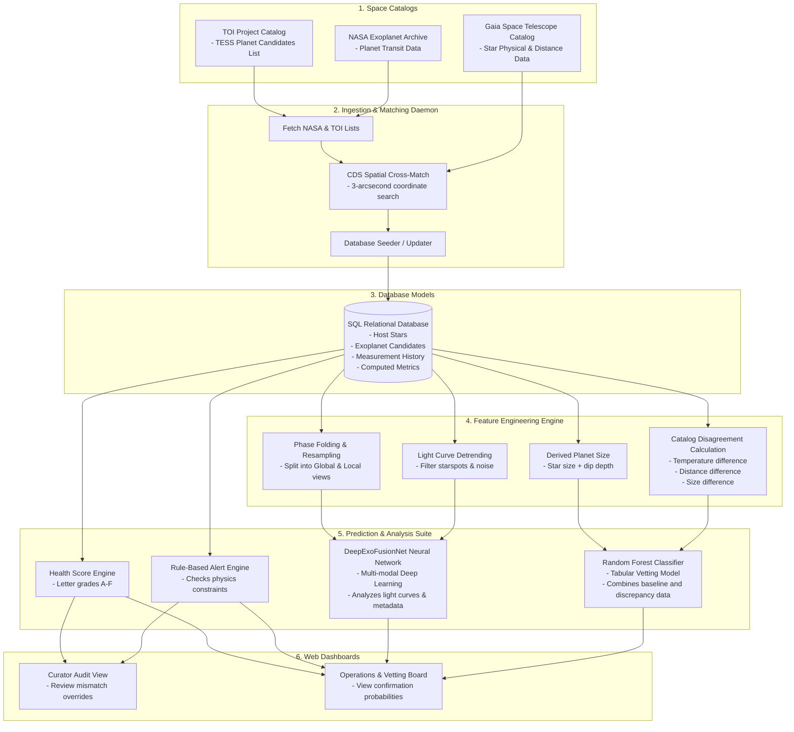

# Exoplanet Evidence Fusion Network (EEFN) - Complete Data Flow Guide

This document is a comprehensive, step-by-step guide to the end-to-end data flow of the EEFN platform. It explains how raw data from space telescopes is gathered, matched, cleaned, transformed into features, and analyzed by artificial intelligence to tell the difference between a real planet and a database error.

---

## 1. High-Level Data Flow Architecture

The diagram below shows how data travels through the system from the initial space telescopes and catalogs to the databases, machine learning engines, and user-facing dashboards.



---

## 2. Inbound Data Formats and Types (What We Fetch)

We pull data from three distinct catalogs/databases to get a complete picture of each target. Below are the details, descriptions, data types, and concrete examples of the fields we ingest:

### A. TOI Catalog (TESS Objects of Interest)
This is TESS's candidate list of newly detected signals. It provides the initial transit measurements (how the light curve dims) and the host star's initial estimates.

| Field Name | Data Type | Description | Example Value | What it Means in Plain English |
| :--- | :--- | :--- | :--- | :--- |
| `toi` | `string` | TESS Object of Interest Identifier | `"1017.01"` | Candidate planet #1 orbiting star system 1017. |
| `tid` | `integer` | TESS Input Catalog Identifier (TIC ID) | `261108234` | The unique ID of the host star in TESS's catalog. |
| `ra` | `float` | Right Ascension (position in degrees) | `120.4567` | Horizontal position of the star in the sky (sky longitude). |
| `dec` | `float` | Declination (position in degrees) | `-45.1234` | Vertical position of the star in the sky (sky latitude). |
| `st_tmag` | `float` | TESS stellar brightness magnitude | `10.23` | How bright the star looks. Lower numbers mean a brighter star. |
| `st_teff` | `float` | Stellar Effective Temperature (in Kelvin) | `5600.0` | Surface temperature of the star in TESS's catalog. |
| `st_rad` | `float` | Stellar Radius (in Solar units) | `1.20` | Size of the star. `1.20` means it is 20% larger than our Sun. |
| `st_dist` | `float` | Stellar Distance (in parsecs) | `150.3` | How far away the star is (approx. 490 light-years). |
| `pl_orbper` | `float` | Orbital Period (in days) | `3.524` | The length of the planet's year (how long it takes to orbit once). |
| `pl_trandurh`| `float` | Transit Duration (in hours) | `2.50` | How long the planet takes to cross in front of the star. |
| `pl_trandep` | `float` | Transit Depth (parts per million - ppm) | `1600.0` | How much the star dims. `1600 ppm` means it dims by 0.16%. |
| `pl_rade` | `float` | Planet Radius (in Earth units) | `2.40` | Estimated planet size in TESS's catalog. |
| `pl_insol` | `float` | Planet Insolation Flux (Earth units) | `120.5` | The heat the planet receives. `120.5` times what Earth gets from the Sun. |
| `pl_eqt` | `float` | Planet Equilibrium Temperature (Kelvin) | `750.0` | The estimated temperature of the planet (approx. 477°C / 890°F). |

### B. NASA Exoplanet Archive
This is the master science database hosted by Caltech/IPAC. While TESS detects the candidate, the NASA Exoplanet Archive contains the final vetted decisions from the global scientific community. We use it to get our "ground truth" labels.

| Field Name | Data Type | Description | Example Value | What it Means in Plain English |
| :--- | :--- | :--- | :--- | :--- |
| `tfopwg_disp`| `string` | TESS Follow-up Working Group disposition | `"PC"` | Current label: `PC` (Planet Candidate), `CP` (Confirmed Planet), `FP` (False Positive), `FA` (False Alarm). |

* **How it connects to the database:** The `tfopwg_disp` column is imported directly as the `disposition` field in our `exoplanet_candidates` table. It tells our models whether the object was ultimately confirmed by telescopes on the ground or declared an error.

### C. Gaia Space Telescope (ESA Gaia DR3)
Gaia is an independent space telescope mapping stars with extreme precision. It does not search for planets, but it measures stars directly, providing a clean baseline.

| Field Name | Data Type | Description | Example Value | What it Means in Plain English |
| :--- | :--- | :--- | :--- | :--- |
| `Source` | `string` | Gaia Unique Star Identifier | `"53123456789"` | The unique ID of the star in Gaia's database. |
| `Plx` | `float` | Parallax (stellar shift in milliarcseconds)| `6.65` | Measurement used to calculate distance. |
| `RUWE` | `float` | Renormalised Unit Weight Error | `1.05` | **Stellar Wobble:** Measures if the star deviates from a single-star path. If $> 1.4$, it is likely a binary star system. |
| `Gmag` | `float` | Gaia G-band stellar magnitude | `10.15` | How bright the star looks to Gaia's main camera. |
| `Teff` | `float` | Gaia surface temperature (Kelvin) | `5550.0` | The star's surface temperature calculated by Gaia. |
| `Rad` | `float` | Gaia stellar radius (Solar units) | `1.25` | The star's physical size calculated by Gaia. |
| `Dist` | `float` | Gaia stellar distance (parsecs) | `150.1` | How far away the star is calculated by Gaia. |

---

## 3. Database Schema (How Data is Stored)

The ingested data is stored in a relational SQLite database (`eefn.db`). Here is how the tables are structured and how they link together:

```
+-----------------------------------+         +-----------------------------------+
|            host_stars             |         |       exoplanet_candidates        |
+-----------------------------------+         +-----------------------------------+
| PK | id (UUID)                    | <-----+ | PK | id (UUID)                    |
|    | hostname (String)            |         | FK | host_id (UUID)               |
|    | ra, dec (Float)              |         |    | tic_id (Integer)             |
|    | parallax, distance (Float)   |         |    | toi_id (Float)               |
|    | teff, logg, rad, mass (Float)|         |    | pl_name, disposition (String)|
|    | created_at (DateTime)        |         |    | orbper, rade, trandep (Float)|
+-----------------------------------+         |    | trandurh, insol, eqt (Float) |
                  |                           |    | updated_at (DateTime)        |
                  |                           +-----------------------------------+
                  |                                             |
                  |                                             |
                  v                                             v
+-----------------------------------+         +-----------------------------------+
|        measurement_history        |         |         agreement_metrics         |
+-----------------------------------+         +-----------------------------------+
| PK | id (UUID)                    |         | PK | id (UUID)                    |
| FK | candidate_id (UUID) ---------|---------+ FK | candidate_id (UUID) [Unique]  |
| FK | source_id (UUID)             |         |    | teff_disagreement (Float)    |
|    | parameter_name (String)      |         |    | rad_disagreement (Float)     |
|    | value (Float)                |         |    | dist_disagreement (Float)    |
|    | error_upper, error_lower(Fl) |         |    | ruwe (Float)                 |
|    | measured_at (DateTime)       |         |    | derived_rp_diff (Float)      |
+-----------------------------------+         |    | is_unphysical_rp (Boolean)   |
                  ^                           |    | completeness_score (Float)   |
                  |                           |    | catalog_agreement_score (Fl) |
                  |                           +-----------------------------------+
+-----------------------------------+                           |
|          catalog_sources          |                           v
+-----------------------------------+         +-----------------------------------+
| PK | id (UUID)                    |         |          ml_predictions           |
|    | name (String) [Unique]       |         +-----------------------------------+
|    | version (String)             |         | PK | id (UUID)                    |
|    | last_sync (DateTime)         |         | FK | candidate_id (UUID) [Unique]  |
+-----------------------------------+         |    | evidence_consistency_score (Fl)|
                                              |    | followup_priority_score (Fl) |
                                              |    | feature_importance (JSON)    |
                                              |    | calculated_at (DateTime)     |
                                              +-----------------------------------+
```

---

## 4. Step-by-Step Feature Engineering with Examples

Feature engineering is the process of taking raw database columns and combining them to highlight inconsistencies. Here is exactly how we calculate these features:

### A. Catalog Disagreement (Mismatches)
We calculate the absolute difference (distance between numbers) and the relative difference (percentage mismatch) between catalogs.

#### 1. Temperature Mismatch Example:
*   **TESS Star Temperature (`st_teff`):** $5600.0\text{ K}$
*   **Gaia Star Temperature (`Teff`):** $5550.0\text{ K}$
*   **Formula (Absolute Difference):**
    $$\text{teff\_diff} = |\text{st\_teff} - \text{Teff}|$$
    $$\text{teff\_diff} = |5600.0 - 5550.0| = 50.0\text{ K}$$
*   **Formula (Relative Difference):**
    $$\text{teff\_diff\_rel} = \frac{\text{teff\_diff}}{\text{Teff} + 10^{-6}}$$
    $$\text{teff\_diff\_rel} = \frac{50.0}{5550.0 + 10^{-6}} \approx 0.009009 \text{ (or } 0.9\% \text{ discrepancy)}$$

#### 2. Stellar Size Mismatch Example:
*   **TESS Star Size (`st_rad`):** $1.20$ Solar units
*   **Gaia Star Size (`Rad`):** $1.25$ Solar units
*   **Formula (Absolute Difference):**
    $$\text{rad\_diff} = |1.20 - 1.25| = 0.05 \text{ Solar units}$$
*   **Formula (Relative Difference):**
    $$\text{rad\_diff\_rel} = \frac{0.05}{1.25} = 0.04 \text{ (or } 4\% \text{ discrepancy)}$$

---

### B. Recalculating Planet Size (The Physics Validation)
We do not trust the cataloged planet size blindly. We recalculate it using Gaia's star size and the TESS transit depth.

#### Step-by-Step Calculation:
Let's calculate the size of a candidate with the following values:
*   **Gaia Star Size (`Rad`):** $1.25$ Solar units (the star is 1.25 times larger than our Sun).
*   **Transit Depth (`pl_trandep`):** $1600.0\text{ ppm}$ (the light blocks 0.16% of the star).
*   **Original Cataloged Planet Size (`pl_rade`):** $2.40$ Earth units.

1.  **Convert Parts Per Million (ppm) to a decimal fraction:**
    $$\text{Fraction} = 1600.0 \times 10^{-6} = 0.0016$$
2.  **Take the square root of the blocked light fraction:**
    $$\sqrt{0.0016} = 0.04$$
    *(This means the planet's radius is 4% of the star's radius).*
3.  **Multiply by the Gaia Star Size:**
    $$1.25 \times 0.04 = 0.05\text{ Solar units}$$
    *(The planet's radius in solar radius units).*
4.  **Convert Solar units to Earth units (since 1 Solar unit = 109.2 Earth units):**
    $$\text{derived\_rp\_gaia} = 0.05 \times 109.2 = 5.46\text{ Earth units}$$
    *(Our newly derived planet size).*
5.  **Calculate the size discrepancy:**
    $$\text{derived\_rp\_diff} = |5.46 - 2.40| = 3.06\text{ Earth units}$$
6.  **Calculate the relative size discrepancy:**
    $$\text{derived\_rp\_diff\_rel} = \frac{3.06}{2.40} = 1.275 \text{ (a } 127.5\% \text{ size mismatch!)}$$
7.  **Check if the derived size is physically impossible for a planet:**
    Is $\text{derived\_rp\_gaia} > 22.0$ Earth units?
    *   $5.46 > 22.0$ is **False**, so `is_unphysical_rp_gaia = 0`.
    *   If it had been $> 22.0$ (larger than Jupiter's physical envelope limits), it would be set to `1` (True), immediately alerting us that the object is likely a companion star rather than a planet.

---

### C. Light Curve Cleaning & Splitting
A **light curve** is a long list of numbers showing brightness over time.

```
Raw Light Curve:       1.0  \  Starspots rotation wave (Slow variation)
 (Has slow waves)            \___/\       /\___/
                                   \_____/  <- Planet dip (Transit)

Detrended & Cleaned:   1.0  -----------   ------------- (Flat baseline)
 (Filtered baseline)                   \ /
                                        V   <- Transit dip isolated
```

1.  **Detrending:** If a star has rotating starspots, the raw brightness looks like a wave: `[1.01, 1.02, 1.01, 0.99, 0.98]`. We apply a moving median window to calculate this background wave and divide the raw curve by it. This flattens the baseline to exactly `1.0`.
2.  **Phase Folding:** We slice the time-series by the orbital period and stack the dips.
3.  **Resampling (Formatting for AI):**
    *   **Global View (2001 numbers):** We stretch or compress the full orbit into exactly 2001 bins. A typical centered array looks like:
        `[0.0, 0.0, 0.0, ..., -0.0016, -0.0016, ..., 0.0, 0.0]`
        *(centered at 0.0 by subtracting the 1.0 baseline)*
    *   **Local View (201 numbers):** We zoom in on the transit dip, stretching it into exactly 201 bins:
        `[0.0, 0.0, -0.0004, -0.0012, -0.0016, -0.0016, -0.0012, -0.0004, 0.0, 0.0]`

---

## 5. How the Models Work (Detailed Walkthroughs)

We run two models in parallel to vet the candidates:

### Model A: Tabular Model (Random Forest Classifier)
This model evaluates catalog discrepancies. It does not look at time-series graphs; it looks at tables.

#### Step-by-Step Vetting Example:
When a new candidate is evaluated, the system builds an input row (a list of 25 numbers).

```
Candidate Input Row:
[
  3.524,   # 1. pl_orbper (float)
  2.50,    # 2. pl_trandurh (float)
  1600.0,  # 3. pl_trandep (float)
  2.40,    # 4. pl_rade (float)
  120.5,   # 5. pl_insol (float)
  750.0,   # 6. pl_eqt (float)
  10.23,   # 7. st_tmag (float)
  5600.0,  # 8. st_teff (float)
  1.20,    # 9. st_rad (float)
  4.40,    # 10. st_logg (float)
  150.3,   # 11. st_dist (float)
  50.0,    # 12. teff_diff (float)
  0.009,   # 13. teff_diff_rel (float)
  0.05,    # 14. rad_diff (float)
  0.04,    # 15. rad_diff_rel (float)
  0.20,    # 16. dist_diff (float)
  0.0013,  # 17. dist_diff_rel (float)
  0.08,    # 18. tmag_gmag_diff (float)
  5.46,    # 19. derived_rp_gaia (float)
  3.06,    # 20. derived_rp_diff (float)
  1.275,   # 21. derived_rp_diff_rel (float)
  0,       # 22. is_unphysical_rp_gaia (integer / binary)
  1.05,    # 23. RUWE (float)
  0,       # 24. high_ruwe (integer / binary)
  7.0      # 25. completeness (float - count of how many parameters are present)
]
```

1.  **Imputation:** If the distance `st_dist` is missing (`None`), the **SimpleImputer** automatically replaces it with the median value of all training stars (e.g., `122.5`).
2.  **Random Forest Check:** The list of 25 numbers is fed to 100 decision trees. 
    *   *Tree 1* checks: "Is `derived_rp_diff_rel` $> 0.5$?" $\rightarrow$ Yes. "Is `RUWE` $> 1.4$?" $\rightarrow$ No. It votes: **False Positive (0)**.
    *   *Tree 2* checks: "Is `is_unphysical_rp_gaia` $== 1$?" $\rightarrow$ No. "Is `teff_diff` $> 400.0$?" $\rightarrow$ No. It votes: **Confirmed Planet (1)**.
3.  **Averaging:** The 100 trees vote. If 84 trees vote "Confirmed Planet (1)" and 16 vote "False Positive (0)", the **Confirmation Probability** is **$84\%$**.
4.  **Prioritization Score Calculation:** We scale the confirmation probability by star brightness and stellar wobble to prioritize follow-up observations:
    *   *Brightness Factor:* Stars brighter than magnitude 8.0 get a multiplier of 1.0. Stars fainter than magnitude 20.0 get 0.1. Our star is magnitude `10.23`:
        $$\text{brightness\_factor} = \frac{20.0 - 10.23}{12.0} \approx 0.814$$
    *   *Wobble (RUWE) Factor:* If RUWE $\le 1.4$, multiplier is 1.0. If RUWE is high, we divide 1.4 by the RUWE value. Our RUWE is `1.05`, so the multiplier is `1.0`.
    *   *Prioritization Score:*
        $$\text{priority\_score} = 0.84 \text{ (Prob)} \times 0.814 \text{ (Brightness)} \times 1.0 \text{ (Wobble)} \approx 0.684$$

---

### Model B: Deep Learning Model (DeepExoFusionNet)
This model uses a multi-branch neural network to fuse time-series shapes with metadata.

```
Global View (2001 values)  ---> [ 1D CNN Branch ] ---\
                                                     \
Local View (201 values)    ---> [ 1D CNN Branch ] ----+---> [ Fusion Layers ] ---> Class Probabilities
                                                     /      (Concatenate)          1. Planet Transit
Stellar Metadata (8 values) ---> [ MLP Branch ] -----/                             2. Eclipsing Binary
                                                                                   3. Stellar Activity
                                                                                   4. Detector Noise
```

1.  **Branch 1 (Global View CNN):** Processes the 2001 bins using sliding convolutional filters to identify overall patterns (like secondary dips). Outputs a vector of 256 numbers.
2.  **Branch 2 (Local View CNN):** Processes the 201 bins to evaluate dip geometry. Flat-bottomed "U-shapes" indicate a planet, whereas sharp "V-shapes" indicate binary stars clipping each other. Outputs a vector of 128 numbers.
3.  **Branch 3 (Stellar Metadata MLP):** Ingests 8 normalized properties:
    `[Teff/5778.0, Rad, Depth_ppm/10000.0, Derived_Rp/10.0, RUWE, Parallax/10.0, Size_diff, Blending]`
    It passes them through dense layers to output 64 numbers. This scales the geometric shapes from the CNNs with physical units.
4.  **Late Fusion & Output:** The network concatenates the three vectors into a single list of $448$ numbers ($256 + 128 + 64$). This list is passed to a final classification layer that outputs four percentages summing to 1.0 (e.g., Planet Transit: $92\%$, Eclipsing Binary: $4\%$, Stellar Activity: $2\%$, Detector Noise: $2\%$).

---

## 6. Alert Deductions & Health Score Walkthrough

The rule engine in `alert_engine.py` evaluates physics boundaries and catalog agreements. Let's walk through a concrete example of how a candidate's health grade is calculated:

### Candidate "TOI-9999.01" Evaluation:
*   Initial Score: **$100.0$**

| Check | Metric Found | Deduction Rule | Score Impact | Remaining Score |
| :--- | :--- | :--- | :--- | :--- |
| **Initial** | - | Starts at 100.0 | - | **100.0** |
| **Temperature** | Mismatch $= 240.0\text{ K}$ | $-1$ point per $20\text{ K}$ mismatch (max $-20$) | $240 / 20 = -12.0$ | **88.0** |
| **Size** | Mismatch $= 0.15\text{ Solar units}$ | $-1$ point per $0.05$ size mismatch (max $-20$) | $0.15 / 0.05 = -3.0$ | **85.0** |
| **Distance** | Mismatch $= 85.0\text{ parsecs}$ | $-1$ point per $10\text{ pc}$ mismatch (max $-10$) | $85 / 10 = -8.5$ | **76.5** |
| **Stellar Wobble**| Gaia RUWE $= 1.55$ | If RUWE $> 1.4$, deduct $-15$ points | $-15.0$ | **61.5** |
| **Planet Size** | Derived Size $= 14.2\text{ Earth units}$ | If size $> 22.0$, deduct $-25$ points | $14.2 \le 22.0 \rightarrow 0$ | **61.5** |
| **Completeness** | Score $= 1.0$ (All fields present) | $(1.0 - \text{score}) \times 20$ | $(1.0 - 1.0) \times 20 = 0$ | **61.5** |

### Final Result:
*   **Final Health Score:** **$61.5$**
*   **Final Letter Grade:** **D** (since $60 \le 61.5 < 70$)
*   **Active Alerts Generated:**
    1.  `ALERT_HIGH_RUWE_TOI-9999.01` (Severity: HIGH)
    2.  `ALERT_RAD_MISMATCH_TOI-9999.01` (Severity: HIGH)
    3.  `ALERT_DIST_MISMATCH_TOI-9999.01` (Severity: MEDIUM)

Astronomers viewing the dashboard see a **Grade D** candidate with active alerts warning of a companion star companion (wobble) and size discrepancies, indicating they should reject the target.

---

## 7. Data Flow Step-by-Step Summary

| Step | Action | Input Data | Output Data | Purpose |
| :--- | :--- | :--- | :--- | :--- |
| **1** | **Ingest & Match** | RA/Dec coordinates | SQLite Database records | Cross-match and link stars across catalogs |
| **2** | **Feature Engineering**| Raw parameters & light curves | Tabular features & resampled arrays | Prepare data for the machine learning models |
| **3** | **Tabular Vetting** | 25-feature tabular vector | Confirmation probability & Priority score | Predict planet status based on catalog consensus |
| **4** | **Deep Vetting** | Global & Local light curves + metadata | 4-class probability distribution | Identify transit shape signatures (U vs. V shapes) |
| **5** | **Alerts & Health** | Fused parameters & predictions | Diagnostic alerts & Health Grade (A-F) | Provide clear audit reasons and highlight anomalies |

---

## 8. Proposed Unified ML Architecture (ExoFusion-Net v2)

To secure **academic approval from the faculty**, this section outlines our proposed transition from two separate models (Random Forest + 3-Branch CNN) into a **single, unified Multi-Modal Deep Learning Vetting Model (ExoFusion-Net v2)**. 

By combining all catalog data (TESS, Gaia, 2MASS, Pan-STARRS, Spectroscopy) and raw time-series measurements (Global Light Curve, Local Light Curve, Centroid Offset) into one unified database, we can train a far more efficient, cohesive network.

### A. The Unified Vetting Workflow

The diagram below shows how the simplified system operates. Instead of running multiple separate models, we feed everything into a single multi-branch neural network, followed by a rule-based physics check:

```mermaid
flowchart TD
    %% Consolidated Input
    subgraph Input [1. Unified Database]
        TS[Time-Series Data\n- Global Light Curve (2001 bins)\n- Local Light Curve (201 bins)\n- Centroid Offset Path (201 bins)]
        Meta[Stellar Metadata\n- TESS, Gaia, 2MASS, Pan-STARRS\n- High-Resolution Spectroscopy\n- Calculated Catalog Discrepancies]
    end

    %% Unified Network
    subgraph Model [2. Unified Multi-Modal Network]
        direction TB
        G_CNN[Global CNN Branch]
        L_CNN[Local CNN Branch]
        C_CNN[Centroid CNN Branch]
        M_MLP[Metadata MLP Branch]
        
        G_CNN & L_CNN & C_CNN & M_MLP --> Concatenate[Late Fusion Layer\n(Concatenate Features)]
        Concatenate --> Dense[Dense Layers]
        Dense --> Classifier[Softmax Output]
    end

    %% Outputs & Audits
    subgraph Output [3. Vetting Output & Audits]
        Classes[Class Probabilities\n1. Planet Transit\n2. Eclipsing Binary\n3. Stellar Activity\n4. Detector Noise]
        Metrics[Follow-up Priority Score\n- Scaled by Gmag & RUWE]
        Attribution[Feature Attribution Map\n- Integrated Gradients / SHAP]
        Rules[Rule-Based Physics Audit\n- Unphysical size checks\n- Generates Alerts & Health Grade A-F]
    end

    %% Connections
    TS --> G_CNN & L_CNN & C_CNN
    Meta --> M_MLP
    Classifier --> Classes
    Classes --> Metrics
    Classes & Meta --> Rules
    Classifier --> Attribution
```

### B. Input Structure of the Unified Model

The model receives four inputs simultaneously for each candidate:

1.  **Global Light Curve (2001 values - float):** The centered time-series of the full orbit, capturing out-of-transit variations.
2.  **Local Light Curve (201 values - float):** The centered time-series of the transit dip, capturing U-shape vs. V-shape geometry.
3.  **Centroid Offset Path (201 cadences $\times$ 2 channels - float):** The time-series of the star's center-of-light shifts ($\Delta x_c, \Delta y_c$) during transit. A shift in the center of light during transit indicates a background binary star is causing the dimming.
4.  **Stellar & Multi-Band Metadata (28 normalized features - float; see `app/ml/deep_learning_pipeline.py::build_metadata_vector` for the authoritative field-by-field source of truth, this list is kept in sync with it):**
    *   *Value slots (18):* normalized `st_teff`/`teff_diff`/`st_rad`/`rad_diff`/`st_dist`/`trandep`/`ruwe`, 2MASS `j_mag`/`k_mag`/`h_mag`, Pan-STARRS `g_mag`/`r_mag` (2 of 5 bands), `fe_h`, `derived_rp_diff`, `density_discrepancy_sigma`, `query_failed`, `blending`, `completeness`.
    *   *Presence bits (10, UPGRADE_PLAN.md F.2):* one paired 1.0/0.0 bit per optional-catalog-derived value above (`ruwe_present`, `st_teff_present`, `st_rad_present`, `st_dist_present`, `j_mag_present`, `k_mag_present`, `h_mag_present`, `fe_h_present`, `g_mag_present`, `r_mag_present`) -- lets the network distinguish "measured at the default value" from "not measured, defaulted to it", so a missing catalog never silently looks identical to a real measurement (UPGRADE_PLAN.md A.6).

---

### C. Why this Unified Model is Far More Efficient

Combining all data into a single multi-branch network provides massive advantages over the current split architecture:

1.  **Single-Pass Inference (Higher Computational Speed):** 
    Instead of loading and running two separate model pipelines (the Random Forest and the Deep Learning network), the system processes the inputs in a single forward pass. This reduces memory footprint and enables real-time screening of thousands of candidates.
2.  **Cross-Modal Feature Learning:** 
    A decision tree (Random Forest) cannot see the shape of the light curve, and a CNN cannot see the catalog differences. By fusing them in a single network, the model learns the non-linear physics relating them. For example, the network can learn that *if a transit shape is V-shaped (detected by the Local CNN) and the star's metallicity is high (detected by the MLP), it is highly likely to be a specific type of eclipsing binary*.
3.  **Built-in Centroid Vetting (Spatial Awareness):**
    By adding the Centroid CNN branch, the network directly processes the pixel-level movement. It can immediately correlate a dip in brightness (Local CNN) with a shift in the center of light (Centroid CNN) to identify background binary stars.
4.  **Unified Interpretability (No Mock SHAP Needed):**
    Instead of using separate feature importance methods for the Random Forest, we can use neural network interpretability tools like **Integrated Gradients**. This mathematically calculates how much each input pixel, light curve data point, or metadata parameter contributed to the final probability, displaying it as a unified heat map on the user dashboard.
5.  **Simpler Vetting Output:**
    The unified model outputs the probability of a "Planet Transit." We no longer need a separate model to calculate confirmation probability—the **Planet Transit Probability** serves as the confirmation probability directly, which is then scaled by brightness and wobble to output the follow-up priority score.

